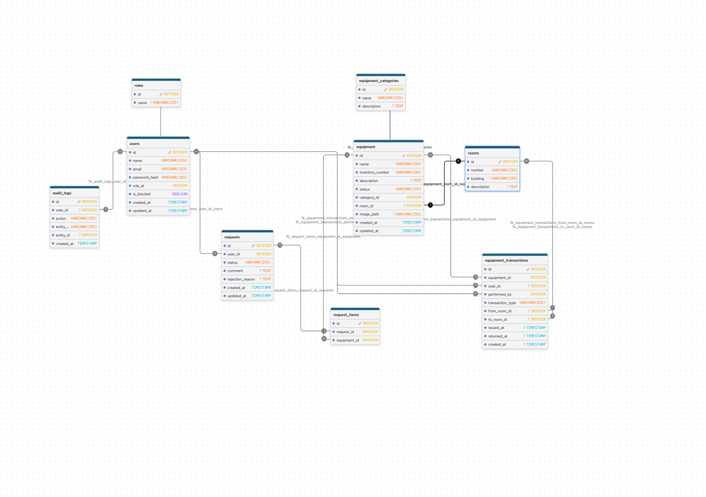

# College Equipment System

Система учёта оборудования и аудиторий колледжа

## Формат проекта

Командный проект, 2 человека

## Тема

Учёт оборудования и аудиторий колледжа

## Цель проекта

Разработать веб-приложение для учёта оборудования колледжа, его размещения по аудиториям, выдачи преподавателям, возврата и просмотра истории перемещений

## Роли пользователей

- Преподаватель
- Лаборант
- Администратор

## Основной функционал

- регистрация и авторизация;
- разграничение прав доступа;
- управление оборудованием;
- управление категориями оборудования;
- управление аудиториями;
- выдача и возврат оборудования;
- история перемещений;
- поиск, фильтрация, сортировка и пагинация;
- личный кабинет пользователя;
- административная панель;
- дашборд со статистикой;
- загрузка файлов;
- журнал аудита;
- экспорт отчётов.

## ER-диаграмма

Схема базы данных проекта:

## Участники

- Участник 1 — Опевалова Полина Алексеевна
- Участник 2 — Мизаева Иман Эдалбековна